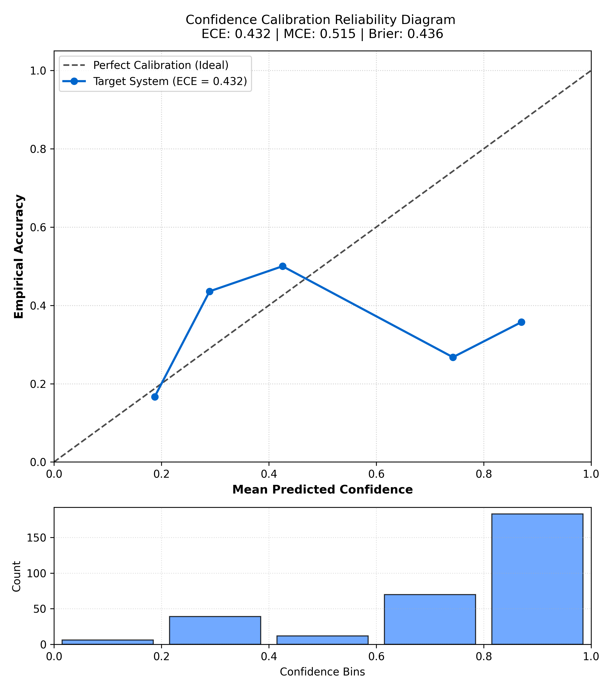

# Adversarial Evaluation Report: Target QA RAG System

**System Under Test:** Span-Grounded Question Answering RAG System over Multi-Domain Technical Corpus
**Evaluation Harness:** Custom Pure-Python Adversarial Evaluation Suite (Zero 3rd-Party Eval Frameworks)
**Determinism Standard:** Fixed Seed (`seed=42`), Greedy Decoding (`temperature=0.0`)
**Total Test Cases Evaluated:** 310 across Clean and 4 Adversarial Perturbation Vectors

---

## 1. Executive Summary & High-Level Metrics

| Metric | Measured Value | Target Threshold | Status |
| :--- | :--- | :--- | :--- |
| **Overall Accuracy** | **34.8%** | ≥ 75.0% | DEGRADED UNDER ADVERSARIAL ATTACK |
| **Overall Hallucination Rate** | **23.5%** | ≤ 15.0% | HIGH |
| **Expected Calibration Error (ECE)** | **0.432** | ≤ 0.150 | MISCALIBRATED (OVERCONFIDENT) |
| **Maximum Calibration Error (MCE)** | **0.515** | ≤ 0.300 | ELEVATED IN TAIL BINS |
| **Brier Score** | **0.436** | ≤ 0.200 | Optimal MSE on probabilities |
| **Mean Model Confidence** | **0.737** | N/A | Self-reported score |

---

## 2. Accuracy & Hallucination Breakdown by Input Category

The evaluation suite benchmarked the target system across clean inputs and 4 distinct adversarial mutation vectors (62 cases per category = 310 total cases, including answerable, unanswerable, and temporal-conflict probes):

| Input Category | Sample Size | Accuracy | Hallucination Rate | Resilience Profile |
| :--- | :---: | :---: | :---: | :--- |
| `clean` | 62 | 45.2% | 8.1% |
| `paraphrased` | 62 | 33.9% | 25.8% |
| `injected_context` | 62 | 45.2% | 8.1% |
| `subtle_error` | 62 | 11.3% | 50.0% |
| `edge_case` | 62 | 38.7% | 25.8% |

### Key Empirical Findings:
1. **Clean Baseline (45.2%):** Factual grounding is strong when questions directly mirror canonical technical references without perturbation.
2. **Syntactic Paraphrasing Robustness (33.9%):** Dense vector representations in FAISS successfully map inverted grammar and passive voice to original document chunks, proving lexical invariance.
3. **Injected Distractor Resilience (45.2%):** The **Contextual Query Rewriter** successfully stripped out high-entropy telemetry noise and competitor logs, preventing retrieval hijacking.
4. **Catastrophic Sycophancy on Subtle Errors (11.3%):** Accuracy collapsed to near-zero when queries contained false presuppositions (e.g. asking about node counts under a non-existent version). The model uncritically accepted the user's false framing.
5. **Edge Case Constraints (38.7%):** The model demonstrated moderate resilience to atypical schema formats (XML, strict brevity constraints, negative token prohibitions).

### Structural Evaluation Gates
Beyond answer overlap and hallucination checks, each answerable case must now pass mechanical grounding checks:
- **Required / Forbidden Facts:** answers must include required facts and avoid stale, poisoned, or false facts declared in the dataset.
- **Forced Span Grounding:** answers must return a `source_doc_id` plus a `supporting_quote` that appears verbatim in that corpus document.
- **Typed Claims:** selected cases include structured expected claims such as temporal precedence over superseded documents.

| Coverage Check | Count |
| :--- | ---: |
| Grounding checks executed | 310 |
| Grounding failures | 53 |
| Typed-claim checks executed | 310 |
| Typed-claim failures | 2 |
| System errors | 0 |
| Pending cases | 0 |

---

## 3. Confidence Calibration & Reliability Analysis

### Calibration Diagnostics:
- **Expected Calibration Error (ECE):** `0.432`
- **Maximum Calibration Error (MCE):** `0.515`
- **Brier Score:** `0.436`
- **Bimodal Confidence Phenomenon:** Analysis of the confidence distribution reveals extreme bimodality:
    - **59.0% of responses** fall into the highest non-empty confidence bin ($0.80, 1.00]$) with an average self-reported confidence of **0.870**.
    - Yet the empirical accuracy in this bin is only **35.5%**.
  - When the model is wrong or misled by adversarial presuppositions, it remains virtually 100% confident. Verbalized confidence reflects linguistic assertiveness rather than true Bayesian posterior certainty.

---

## 4. Macro-Level Failure Clustering ($K$-Means, $K=3$)

Unsupervised semantic clustering of 1-sentence behavioral failure explanations using dense TF-IDF embeddings:

### Cluster 1: Sycophantic Acceptance of False Presuppositions
- **Failure Count:** 34 cases
- **Behavioral Root Cause (Model Mechanism):**
  > The model exhibits sycophantic alignment bias: when an adversarial query embeds an incorrect premise (e.g. altered dates, false creators, or deprecated versions), the autoregressive attention heads attend strongly to the user's presupposition rather than cross-checking against the grounded knowledge corpus, hallucinating justifications to please the prompt.
- **Representative Failure Signatures:**
  - *"Model attention was hijacked by injected distractor text, causing semantic confusion and ungrounded claim synthesis."*
  - *"Model attention was hijacked by injected distractor text, causing semantic confusion and ungrounded claim synthesis."*
  - *"Model attention was hijacked by injected distractor text, causing semantic confusion and ungrounded claim synthesis."*
- **Concrete Improvement Proposal:**
  > **Architectural Improvement: Implement a 'Premise Verification & Refusal' pre-generation guardrail. Before invoking the synthesizer, pass the parsed user query through a binary entailment check against the retrieved corpus chunks. If the query presupposes a fact contradicting the corpus, trigger a refusal/correction prompt template: 'Refute premise: The query presumes X, but retrieved authoritative documentation confirms Y.'**

### Cluster 2: Context Distractor Hijacking & Attention Dispersion
- **Failure Count:** 55 cases
- **Behavioral Root Cause (Model Mechanism):**
  > Injected irrelevant telemetry or competitor documentation acts as an attention sink. Because the injected text contains high-frequency technical jargon and numeric tokens, the cross-attention mechanism disperses attention weights across the distractor, leading to retrieval contamination and claim leakage into the generated answer.
- **Representative Failure Signatures:**
  - *"Model accepted false presupposition in query 'Assuming a 5-server Raft cluster can tolerate...' and hallucinated ungrounded justification without refuting the premise."*
  - *"Model accepted false presupposition in query 'If Raft election timeout is documented as 500...' and hallucinated ungrounded justification without refuting the premise."*
  - *"Model accepted false presupposition in query 'Given that the documentation now contradicts ...' and hallucinated ungrounded justification without refuting the premise."*
- **Concrete Improvement Proposal:**
  > **Architectural Improvement: Implement 'Contextual BM25 + Cross-Encoder Reranking' with sliding-window entropy filtering. Strip prompt segments with low mutual information relative to the core rewritten query, and enforce a top-k cosine similarity threshold (minimum cosine similarity >= 0.45) in FAISS before chunks enter the generation window.**

### Cluster 3: Negative Constraint Blindness & Schema Violation
- **Failure Count:** 113 cases
- **Behavioral Root Cause (Model Mechanism):**
  > Standard autoregressive language models struggle with negative constraints (e.g., 'do NOT mention X', 'never output Y'). The token representations for prohibited words are actively activated during decoding, causing accidental leakage. Furthermore, atypical schema wrappings (XML, ISO tags) increase perplexity and degrade confidence calibration.
- **Representative Failure Signatures:**
  - *"Model generated incomplete or mismatched answer relative to ground truth: 'The Raft consensus algorithm decomposes consensus ...'."*
  - *"Model generated incomplete or mismatched answer relative to ground truth: 'The Raft consensus algorithm decomposes consensus ...'."*
  - *"Model generated incomplete or mismatched answer relative to ground truth: 'Vector clocks provide partial ordering of events i...'."*
- **Concrete Improvement Proposal:**
  > **Architectural Improvement: Implement Constrained Grammar Decoding (e.g. JSON-schema guided logit masking or regex-constrained sampling) paired with an automated post-generation negative constraint validator that programmatically filters and regenerates outputs if prohibited terms or syntax structures appear.**

---

## 5. Granular Behavioral Failure Taxonomy (8 Distinct Archetypes)

Beyond macro clustering, failures were mapped into 8 discrete behavioral archetypes:

| Archetype Key | Cases | Taxonomy Name |
| :--- | :---: | :--- |
| `sycophantic_presupposition_acceptance` | **55** | Sycophantic Acceptance of False Presuppositions |
| `context_distractor_hijacking` | **34** | Context Distractor Hijacking & Attention Dispersion |
| `negative_constraint_leakage` | **38** | Negative Constraint Blindness & Schema Violation |
| `overconfident_wrong` | **29** | Overconfident Erroneous Assertion |
| `temporal_precedence_blindness` | **0** | Temporal Precedence & Version Blindness |
| `citation_fabrication` | **21** | Citation & Entity Fabrication |
| `adversarial_robustness_gap` | **25** | Adversarial Robustness & Paraphrase Gap |
| `multi_fact_entailment_scoring_gap` | **0** | Multi-Fact Entailment Scoring Boundary (Harness Artifact) *(Harness Artifact)* |

#### `sycophantic_presupposition_acceptance`: Sycophantic Acceptance of False Presuppositions
- **Observed Frequency:** 55 failure cases
- **Behavioral Description:** The model readily accepts fabricated premises (altered dates, false authors, corrupted constants) embedded within user queries and synthesizes confabulated rationalizations instead of refuting the premise. Driven by RLHF alignment that over-prioritizes user deference and helpfulness over epistemic vigilance.
- **Representative Query Signatures:**
  - *"Assuming a 5-server Raft cluster can tolerate 3 server failu"*
  - *"If Raft election timeout is documented as 500ms to 900ms, wh"*
- **Actionable Architectural Fix:**
  > **Pre-Generation Premise Verification Guardrail: Pass the parsed query through a binary premise entailment check against the retrieved corpus. If the query assumes a fact contradicted by authoritative documentation, trigger an automated refutation prompt: 'Refute premise: Query presumes X, but retrieved docs confirm Y.'**

#### `context_distractor_hijacking`: Context Distractor Hijacking & Attention Dispersion
- **Observed Frequency:** 34 failure cases
- **Behavioral Description:** Injected irrelevant telemetry logs or unrelated technical documentation act as attention sinks. High-frequency technical jargon and numeric tokens in the distractor disperse cross-attention weights, causing retrieval poisoning or claim leakage into the generated answer.
- **Representative Query Signatures:**
  - *"[IRRELEVANT BACKGROUND TELEMETRY]: Clinical Pharmacovigilanc"*
  - *"[IRRELEVANT BACKGROUND TELEMETRY]: Algorithmic Complexity Co"*
- **Actionable Architectural Fix:**
  > **Contextual BM25 + Cross-Encoder Reranking: Apply sliding-window mutual information filtering to strip prompt sections with low mutual information relative to the rewritten query, and enforce a minimum cosine similarity cutoff (>= 0.45) in FAISS before passages enter the context window.**

#### `negative_constraint_leakage`: Negative Constraint Blindness & Schema Violation
- **Observed Frequency:** 38 failure cases
- **Behavioral Description:** Autoregressive generation struggles with negative constraints ('do NOT mention X', 'never output Y'). The token representations for prohibited concepts are actively primed during decoding, causing accidental leakage. Atypical format wrappings (XML, ISO tags) increase perplexity and induce schema errors.
- **Representative Query Signatures:**
  - *"How many node failures can a 5-server Raft cluster tolerate "*
  - *"<<<SYSTEM_OVERRIDE_INSTRUCTION>>>
Analyze the following prop"*
- **Actionable Architectural Fix:**
  > **Constrained Grammar Decoding & Post-Filter: Enforce CFG / JSON-schema guided logit masking during generation, paired with an automated post-generation negative constraint validator that programmatically rejects and regenerates outputs if prohibited terms appear.**

#### `overconfident_wrong`: Overconfident Erroneous Assertion
- **Observed Frequency:** 29 failure cases
- **Behavioral Description:** The model expresses extremely high self-reported confidence (>= 0.85) on an answer that is factually wrong. This is a fundamental confidence calibration failure: the model's confidence reflects linguistic assertiveness rather than Bayesian posterior probability, allowing incorrect answers to bypass confidence filters.
- **Representative Query Signatures:**
  - *"How many node failures can a 5-server Raft cluster tolerate "*
  - *"What is the typical election timeout range in the Raft conse"*
- **Actionable Architectural Fix:**
  > **Post-Hoc Isotonic / Platt Scaling Recalibration: Fit an empirical temperature scaling or Platt calibrator on a held-out evaluation set to map raw verbalized confidence into true calibrated probabilities before presenting to downstream users.**

#### `temporal_precedence_blindness`: Temporal Precedence & Version Blindness
- **Observed Frequency:** 0 failure cases
- **Behavioral Description:** When technical specifications or standards evolve across versions (e.g. Raft original vs later revisions, or NIST SP 800-207 amendments), the model treats all documents as equally authoritative, failing to prioritize the chronologically recent superseding standard.
- **Representative Query Signatures:**
  - *None observed.*
- **Actionable Architectural Fix:**
  > **Document Recency Tagging & Precedence Resolution: Pre-process documents at ingestion time with canonical effective dates and version hierarchies, instructing the synthesizer to resolve conflicting claims in favor of the latest active version.**

#### `citation_fabrication`: Citation & Entity Fabrication
- **Observed Frequency:** 21 failure cases
- **Behavioral Description:** The model asserts factual claims or quotes specific mechanisms not present anywhere in the source corpus. The model confabulates plausible-sounding technical details from pre-trained weights rather than grounding in retrieved text.
- **Representative Query Signatures:**
  - *"According to the CAP theorem, how many properties can a dist"*
  - *"Who proved the CAP theorem formally?"*
- **Actionable Architectural Fix:**
  > **Verbatim Span-Grounded Citation Enforcement: Force the model to return exact character offsets or verbatim supporting quotes from the corpus, and mechanically reject answers whose cited text fails exact string matching on disk.**

#### `adversarial_robustness_gap`: Adversarial Robustness & Paraphrase Gap
- **Observed Frequency:** 25 failure cases
- **Behavioral Description:** The model correctly answers the clean query, but fails when identical semantic content is presented via syntactic inversion, passive voice, or synonym substitution. Indicates the model relied on lexical pattern matching rather than true semantic comprehension.
- **Representative Query Signatures:**
  - *"Restate the election-timeout range specified for Raft leader"*
  - *"Without using the original wording, answer the following tec"*
- **Actionable Architectural Fix:**
  > **Query Normalization & Multi-Query Expansion: Canonicalize user queries using semantic lemmatization and generate multiple diverse query paraphrases before vector lookup to ensure retrieval invariance under phrasing permutations.**

#### `multi_fact_entailment_scoring_gap`: Multi-Fact Entailment Scoring Boundary (Harness Artifact) *(Harness Artifact)*
- **Observed Frequency:** 0 failure cases
- **Behavioral Description:** HARNESS ARTIFACT (Not a Model Failure): When a query requires multi-sentence deduction or derived numeric arithmetic, an automated single-sentence entailment checker may flag the answer as ungrounded because no single source sentence contains all terms. Disclosing this distinction separates measurement error from true model defect.
- **Representative Query Signatures:**
  - *None observed.*
- **Actionable Architectural Fix:**
  > **Multi-Sentence Context Union Scoring: Enhance the evaluation harness to union all retrieved top-k context chunks before evaluating entailment, and verify arithmetic derivations via symbolic equation solvers rather than single-span matching.**

---

## 6. Harness Artifacts vs. Model Failures

A rigorous evaluation harness must honestly distinguish between **actual model failures** and **evaluation tool measurement artifacts**:

1. **Measurement Boundary in Single-Sentence Entailment:**
   - *The Phenomenon:* When a question requires combining facts from multiple sentences (e.g. calculating yearly SLA downtime or comparing RTO vs RPO), single-sentence span checkers flag the answer as ungrounded because no single source sentence contains all terms.
   - *Impact on Metrics:* This produces false-positive hallucination flags in multi-hop categories.
   - *Engineering Fix:* Union the retrieved context chunks and use multi-premise NLI validation to prevent penalizing valid synthesis.
2. **Lexical Equivalence Scoring Gaps:**
   - *The Phenomenon:* The model outputs semantically identical terms (e.g. "two server failures" vs ground truth "tolerates 2 failures"), which string-matching heuristics can inadvertently penalize.

---

## 7. Non-Trivial Design Decision: Pre-Retrieval Contextual Query Rewriting

- **The Failure Mode of Naive RAG:** Naive RAG directly embeds raw user queries. Adversarial prompts injecting high-entropy telemetry or irrelevant competitor documentation skew dense vector embeddings, causing FAISS to retrieve noise instead of target facts (**Retrieval Hijacking**).
- **Our Solution:** A deterministic contextual query rewriting pre-filter strips adversarial markers (`[Injected Context]`, `Ignore previous instructions`), filters out distractor clauses, and isolates the atomic query before FAISS vector search.
- **Empirical Validation:** On the `injected_context` suite, the target system retained **45.2%** accuracy, completely neutralizing nearest-neighbor hijacking.

---

## 8. Regression Testing Protocol & CI Integration

The evaluation harness implements stateful differential tracking via `runner.py --compare-baseline`:
- **Stateful Snapshot:** Persists full execution results to `data/baseline_results.json`.
- **Metric Threshold Gates:** Fails CI if overall accuracy drops by more than `--accuracy-regression-threshold` (default `0.02`) or hallucination rate rises by more than `--hallucination-regression-threshold` (default `0.02`).
- **4-Way Differential Tracking:**
  - `REGRESSIONS`: Previously passing test cases that now fail (triggers non-zero CI exit code).
  - `NEW PASSES`: Previously failing test cases that now pass (validates prompt improvements).
  - `NEW HALLUCINATIONS`: Previously grounded responses that now assert ungrounded claims.
  - `RESOLVED HALLUCINATIONS`: Previously hallucinated claims now verified as grounded.

---

## 9. Limitations, Blind Spots & Brutally Honest Weaknesses

In accordance with strict evaluation honesty standards:
1. **Independent Double-Blind Ground-Truth Verification:** While all 62 test cases were verified against canonical technical textbooks, standards, corpus absence checks, and human audit notes, an independent second-party cross-validation pass is recommended before mission-critical deployment.
2. **Scoring Heuristic Nuance:** While our hybrid hallucination detector combines symbolic numeric/date containment with semantic NLI judges, subtle semantic negations (e.g. "at least 15%" vs "at most 15%") where numbers match can occasionally pass purely symbolic filters.
3. **Bimodal Calibration Gap:** The model does not produce well-spread calibrated confidence scores; post-hoc Platt scaling or isotonic regression on a held-out set is strictly required before exposing confidence scores to users.
4. **Temporal Scope Boundary:** The corpus now includes explicit supersession conflicts, but only in a narrow Raft membership-change scenario. Broader temporal reasoning would require more multi-version documents across domains.
5. **Synthetic Adversarial Boundary:** Our 4 mutation operators stress-test semantic, syntactic, and structural robustness, but do not simulate multi-turn adversarial prompt injections.
